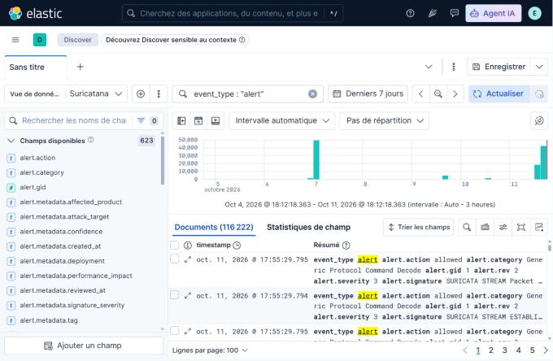
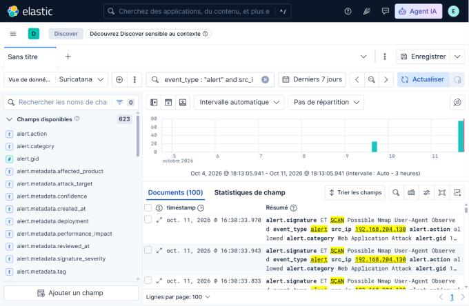
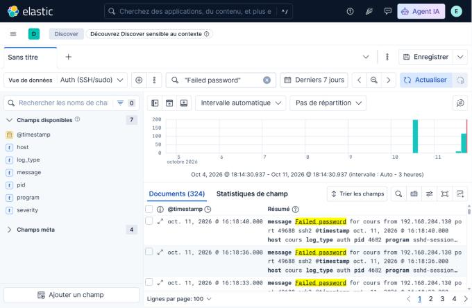
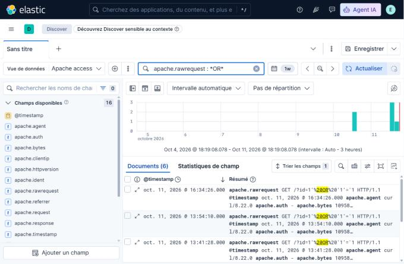
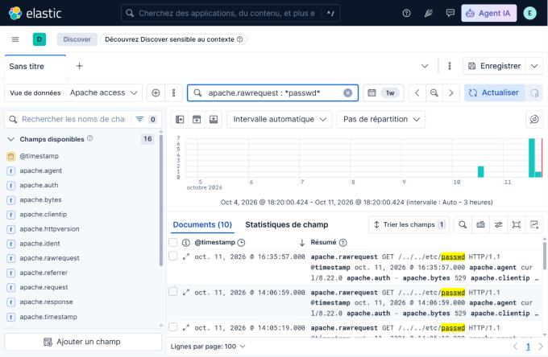
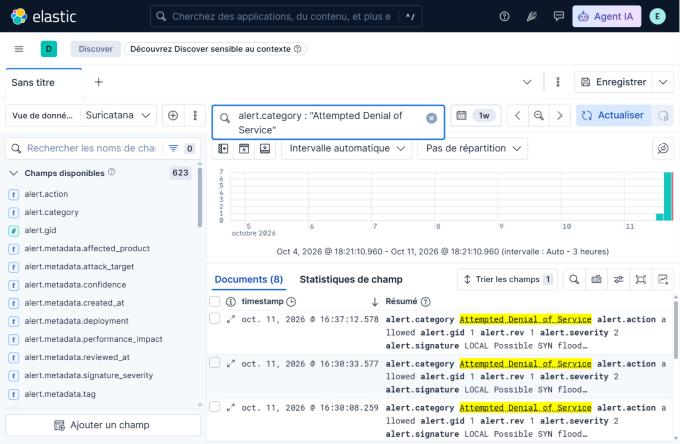
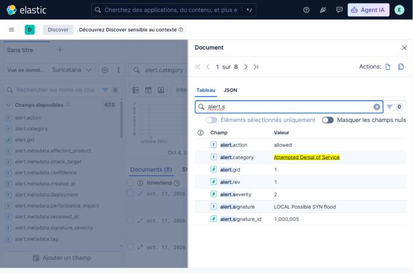

# Captures Kibana et explications

*Captures Kibana et Slack du projet, avec le réglage utilisé et leur lecture.*

## Capture 1 : Vue d'ensemble des alertes

*Vue de données : **Suricatana** · Filtre : `event_type : "alert"`*

*Capture 1 : Kibana, Discover, vue Suricatana : toutes les alertes Suricata sur les 7 derniers jours.*

Le filtre `event_type : "alert"` ne garde que les alertes de sécurité : Kibana en compte 116 222 sur les 7 derniers jours. Le graphique du haut montre le nombre d'alertes dans le temps.

Les très gros pics (autour de 50 000 alertes le 7 octobre, puis de nouveau le 11) sont presque entièrement des alertes parasites `SURICATA STREAM ...`, dues à la carte réseau virtuelle de la VM (voir la partie « limites »). Les barres plus petites correspondent à nos tests : ping, scan, brute-force, attaques web.

## Capture 2 : Scénario 1 : scan de ports (nmap)

*Vue de données : **Suricatana** · Filtre : `event_type : "alert" and src_ip : "192.168.204.130" and alert.signature : *SCAN*`*

*Capture 2 : Alertes ET SCAN déclenchées par le scan nmap lancé depuis la Kali (192.168.204.130).*

Le filtre garde les alertes dont la source est la Kali (`src_ip`) et dont la signature contient `SCAN`. Kibana en trouve 100, toutes de la signature `ET SCAN Possible Nmap User-Agent Observed`, rangée par Suricata dans la catégorie `Web Application Attack`.

C'est l'alerte attendue : avec l'option `-A`, nmap lance des scripts qui envoient des requêtes web avec un User-Agent propre à nmap, et c'est cette empreinte que la règle ET SCAN reconnaît. Le lien avec le log brut se fait par `src_ip` (la Kali) et par la signature affichée dans le champ `alert.signature`.

## Capture 3 : Scénario 2 : brute-force SSH (hydra)

*Vue de données : **Auth (SSH/sudo)** · Filtre : `"Failed password"`*

*Capture 3 : Échecs de connexion SSH répétés dans auth.log, tous depuis 192.168.204.130.*

Dans la vue Auth, la recherche de « Failed password » ramène 324 lignes de `auth.log` sur la période. Chaque ligne dit la même chose : `Failed password for cours from 192.168.204.130 ... ssh2`, produite par `sshd`.

Ce qui trahit le brute-force, c'est la répétition : une nouvelle tentative toutes les 3 à 4 secondes, toujours vers le même compte (`cours`) et depuis la même adresse, celle de la Kali. Ce scénario se voit donc dans les journaux du système (`auth.log`) et pas seulement dans Suricata.

## Capture 4 : Scénario 3 : injection SQL

*Vue de données : **Apache access** · Filtre : `apache.rawrequest : *OR*`*

*Capture 4 : Requêtes Apache contenant l'injection 1' OR '1'='1, vues dans access.log.*

Dans la vue Apache access, le filtre sur le champ `apache.rawrequest` isole 6 requêtes qui contiennent `OR`. Chacune est de la forme `GET /?id=1' OR '1'='1 HTTP/1.1` (les espaces apparaissent encodés en `%20`), envoyée avec `curl`.

Le motif `' OR '1'='1` est le classique de l'injection SQL : il rend une condition toujours vraie pour contourner un contrôle. Le log Apache montre la requête exactement telle que le serveur l'a reçue, ce qui permet de la retrouver et de la dater.

## Capture 5 : Scénario 4 : traversée de répertoires

*Vue de données : **Apache access** · Filtre : `apache.rawrequest : *passwd*`*

*Capture 5 : Requêtes Apache GET /../../etc/passwd, vues dans access.log.*

Le filtre `apache.rawrequest : *passwd*` ramène 10 requêtes de la forme `GET /../../etc/passwd HTTP/1.1`. Les `../` servent à remonter dans l'arborescence du serveur pour atteindre un fichier système, ici la liste des comptes.

Dans le log brut, la requête apparaît telle quelle dans `apache.rawrequest`. Le code de réponse HTTP se lit dans le champ `apache.response` du même document.

## Capture 6 : Scénario 5 : SYN flood

*Vue de données : **Suricatana** · Filtre : `alert.category : "Attempted Denial of Service"`*

*Capture 6 : Alertes « LOCAL Possible SYN flood » de la catégorie Attempted Denial of Service.*

Le filtre sur la catégorie `Attempted Denial of Service` fait ressortir 8 alertes, toutes de la signature `LOCAL Possible SYN flood`. Le préfixe `LOCAL` indique qu'il s'agit d'une règle écrite par nous dans `local.rules`, pas d'une règle du jeu ET Open.

Ces alertes correspondent aux vagues de paquets SYN envoyées par `hping3` depuis la Kali (ici deux séries, vers 16:30 puis 16:37). La règle (sid 1000005) se déclenche à partir de 50 paquets SYN en 5 secondes vers la même cible et ne lève qu'une alerte par fenêtre grâce à son seuil (`threshold`). Le pic se voit à droite du graphique, le 11 octobre.

## Capture 7 : Détail d'une alerte

*Vue de données : **Suricatana** · Réglage : clic sur l'icône d'ouverture d'une ligne, puis recherche de champs « alert.s »*

*Capture 7 : Détail d'une alerte Suricata : signature, sid, catégorie, sévérité.*

Le panneau « Document » donne tous les champs d'une alerte. Ici, en filtrant les noms de champs sur `alert.s`, on lit : `alert.signature` = `LOCAL Possible SYN flood`, `alert.signature_id` = 1000005 (le sid de notre règle), `alert.category` = `Attempted Denial of Service` et `alert.severity` = 2.

Le champ `alert.action` vaut `allowed` : Suricata est en mode détection (IDS), il signale l'attaque mais ne bloque pas le trafic. Les adresses source et destination de l'alerte sont dans les champs `src_ip` et `dest_ip` du même document.

## Capture 8 : Notification Slack

*Vue : **Slack, canal #nouveau-canal** · Source : robot « Suricatana Alerts »*

*Capture 8 : Messages d'alerte reçus dans Slack pour le brute-force SSH et le SYN flood.*

Le robot `slack_alerts.py` a envoyé ces messages dans le canal #nouveau-canal : un pour le brute-force SSH (`LOCAL Possible SSH bruteforce`, sid 1000004, gravité élevée) et un pour le SYN flood (`LOCAL Possible SYN flood`, sid 1000005, gravité élevée).

Chaque message donne la gravité, la signature, la catégorie, la source et la cible (ici de la Kali 192.168.204.130 vers la VM 192.168.204.129), le nombre d'occurrences, une explication en français simple et la marche à suivre dans Kibana. Des messages du même format sont aussi arrivés pour l'injection SQL (sid 1000002) et la traversée de répertoires (sid 1000003). L'heure affichée est celle de la VM.

## Capture 9 : Dashboard personnalisé « Sauron »

*Vue de données : **Dashboard « Sauron »** · Filtre : `aucun filtre global, 7 derniers jours`*

*Capture 9 : Dashboard Kibana « Sauron » : alertes dans le temps, signatures et IP sources, top des IP sources, codes HTTP Apache.*

Le dashboard « Sauron » réunit quatre graphiques sur les 7 derniers jours. En haut à gauche, l'histogramme du nombre d'alertes dans le temps, empilé par signature. En haut à droite, le tableau des signatures les plus fréquentes, avec l'IP source de chacune. En bas à gauche, la répartition des codes de réponse HTTP d'Apache (133 requêtes, dont 79 en code 200 et le reste en erreurs 4xx ou 5xx). En bas à droite, le top 10 des IP sources des alertes Suricata.

En tête des signatures on retrouve les alertes parasites `SURICATA STREAM ...`, puis des alertes d'information comme `ET INFO ... Kali Linux Updates` et notre règle de test `TEST ICMP ping detecte`. Dans le top des IP sources, la Kali (192.168.204.130) ressort avec 21 398 alertes, derrière 160.79.104.10, et la VM elle-même (192.168.204.129) apparaît juste après.
