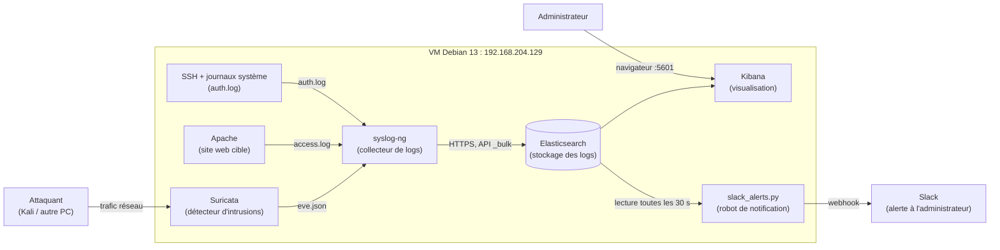
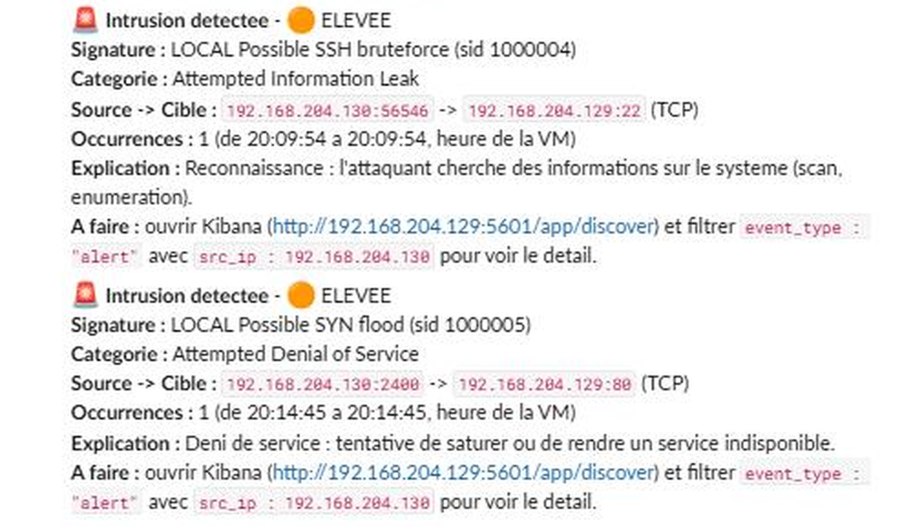
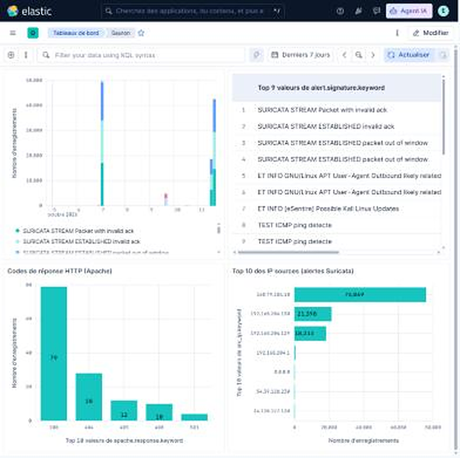

# Compte rendu : mise en place de la machine de détection d'intrusions

*Projet 1 : système de détection d'anomalies et de gestion de logs pour la sécurité des réseaux (Groupe 3).*

**Équipe :** Younes KARMOUCHE, Florian MORDOHAI, Clément RIEUNEAU

> **En une phrase :** on a monté une « caméra de surveillance » pour le réseau. Suricata repère les comportements suspects, syslog-ng apporte les journaux dans Elasticsearch, Kibana permet de les regarder, et un script envoie un message Slack dès qu'une intrusion est repérée.

**Pour aller plus loin :** [Captures et explications](CAPTURES.md) · [Guide d'utilisation](GUIDE-UTILISATION.md) · [Analyse et conclusion](ANALYSE-CONCLUSION.md) · [Vidéo de démonstration](Video%20Projet.mp4)

## 1. Le schéma d'ensemble



**Comment ça se lit :**

1. Le trafic réseau passe devant **Suricata**, qui écrit une ligne dans `eve.json` à chaque événement
   (une alerte, une requête web, une requête DNS...).
2. **syslog-ng** lit trois sources de journaux : `eve.json` (Suricata), `access.log` (Apache) et
   `auth.log` (connexions SSH, `sudo`...), et envoie tout à **Elasticsearch**.
3. **Elasticsearch** range les logs et permet de les chercher très vite.
4. **Kibana** affiche ces logs sous forme de tableaux et de graphiques dans un navigateur.
5. Le **script Slack** regarde les nouvelles alertes et prévient l'administrateur.

---

## 2. La machine

| Élément | Valeur |
|---|---|
| Système | Debian GNU/Linux 13 « trixie » |
| Nom de la machine | `cours` |
| Adresse IP | `192.168.204.129` (interface réseau `ens33`) |
| Mémoire | 7,7 Go (elle avait 3,8 Go au début, on l'a augmentée : trop juste pour Elasticsearch + Kibana) |
| Accès | SSH depuis MobaXterm |

**Versions installées :** Elasticsearch 9.5.5, Kibana 9.5.5, Suricata 7.0.10,
syslog-ng 4.8.1, Apache 2.4.68, Python 3.

---

## 3. Ce qu'on a fait, étape par étape

### Étape A : préparer le système

```bash
sudo apt update && sudo apt upgrade -y
sudo apt install -y curl gnupg apt-transport-https ca-certificates
```

On met le système à jour et on installe les outils pour télécharger des paquets de façon sûre.

### Étape B : installer Elasticsearch (la bibliothèque de logs)

```bash
# 1) ajouter la clé de signature et le dépôt officiel d'Elastic
curl -fsSL https://artifacts.elastic.co/GPG-KEY-elasticsearch | sudo gpg --dearmor -o /usr/share/keyrings/elastic.gpg
echo "deb [signed-by=/usr/share/keyrings/elastic.gpg] https://artifacts.elastic.co/packages/9.x/apt stable main" | sudo tee /etc/apt/sources.list.d/elastic-9.x.list
sudo apt update
# 2) installer
sudo apt install -y elasticsearch
```


**Limiter la mémoire :** par défaut Elasticsearch prend la moitié de la RAM. On le limite à 2 Go
pour laisser de la place aux autres :

```bash
echo -e "-Xms2g\n-Xmx2g" | sudo tee /etc/elasticsearch/jvm.options.d/heap.options
```

**Démarrer et tester :**

```bash
sudo systemctl daemon-reload
sudo systemctl enable --now elasticsearch
sudo curl --cacert /etc/elasticsearch/certs/http_ca.crt -u elastic https://localhost:9200
```

Réponse attendue : un bloc JSON avec `"tagline" : "You Know, for Search"`.

### Étape C : installer Kibana (l'écran de visualisation)

```bash
sudo apt install -y kibana
echo 'server.host: "0.0.0.0"' | sudo tee -a /etc/kibana/kibana.yml     # accessible depuis un autre PC
sudo /usr/share/elasticsearch/bin/elasticsearch-create-enrollment-token -s kibana   # donne un « jeton »
sudo /usr/share/kibana/bin/kibana-setup --enrollment-token <LE_JETON>   # relie Kibana à Elasticsearch
sudo systemctl daemon-reload
sudo systemctl enable --now kibana
```

Le jeton est une sorte de « badge temporaire » (valable 30 minutes) qui permet à Kibana de se
présenter à Elasticsearch. Ensuite, on ouvre `http://192.168.204.129:5601` et on se connecte avec
l'utilisateur `elastic`.

### Étape D : installer Suricata (le détecteur d'intrusions)

> **Pourquoi Suricata et pas Snort ?** Snort n'existe pas dans les dépôts de Debian 13 : il faudrait le
> compiler à la main (long et fragile). Suricata est disponible directement, il utilise des règles de même forme que Snort, et il écrit ses événements
> au format JSON, très pratique pour Elasticsearch.

```bash
sudo apt install -y suricata syslog-ng
```

**Dire à Suricata quelle carte réseau écouter** :

```bash
sudo sed -i '622s/eth0/ens33/' /etc/suricata/suricata.yaml
```

**Télécharger les règles de détection** (environ 69 000 règles, dont 53 000 activées) :

```bash
sudo suricata-update
```

**Démarrer :**

```bash
sudo systemctl enable --now suricata
```

On vérifie avec `sudo tail /var/log/suricata/suricata.log` : on doit lire `Engine started`.

**Une règle de test à nous** (elle déclenche une alerte à chaque `ping`) :

```bash
echo 'alert icmp any any -> $HOME_NET any (msg:"TEST ICMP ping detecte"; itype:8; sid:1000001; rev:1;)' | sudo tee /etc/suricata/rules/local.rules
# puis, dans suricata.yaml, sous « rule-files: », ajouter la ligne :
#   - /etc/suricata/rules/local.rules
sudo suricata -T -c /etc/suricata/suricata.yaml     # test de la configuration
sudo systemctl restart suricata
```

Test réussi : un `ping 192.168.204.129` depuis le PC Windows a produit dans
`/var/log/suricata/fast.log` la ligne `TEST ICMP ping detecte`.

**Nos règles pour les scénarios d'attaque.** En plus du test ICMP, on a écrit quatre règles à la suite dans le même fichier `local.rules` (copie dans `configs/suricata/local.rules`) :

| sid | Règle | Ce qu'elle détecte |
|---|---|---|
| 1000002 | `LOCAL SQLi attempt detected` | injection SQL : une apostrophe puis `OR` dans l'adresse web demandée |
| 1000003 | `LOCAL Path traversal attempt detected` | traversée de répertoires : `../` dans une requête vers le port 80 |
| 1000004 | `LOCAL Possible SSH bruteforce` | brute-force SSH : au moins 3 connexions vers le port 22 en 20 secondes depuis la même IP |
| 1000005 | `LOCAL Possible SYN flood` | SYN flood : au moins 50 paquets SYN en 5 secondes vers la même cible |

Les alertes obtenues dans Kibana sont montrées dans [CAPTURES.md](CAPTURES.md).


### Étape E : brancher syslog-ng sur Elasticsearch (le facteur)

**1) Un compte dédié pour syslog-ng.** On évite de mettre le compte super-admin `elastic` dans un
fichier de config. On crée un rôle qui n'a le droit que d'*écrire* dans nos index, puis un utilisateur :

```bash
# rôle « syslog_writer » (contenu dans configs/elasticsearch/role_syslog_writer.json)
curl --cacert /etc/elasticsearch/certs/http_ca.crt -u elastic -X POST -H 'Content-Type: application/json' \
     -d @role_syslog_writer.json https://localhost:9200/_security/role/syslog_writer
# utilisateur « syslog_ng » avec ce rôle
curl --cacert /etc/elasticsearch/certs/http_ca.crt -u elastic -X POST -H 'Content-Type: application/json' \
     -d '{"password":"<MOT_DE_PASSE>","roles":["syslog_writer"]}' https://localhost:9200/_security/user/syslog_ng
```

**2) Le certificat.** Elasticsearch parle en HTTPS ; on donne son certificat à syslog-ng pour qu'il lui
fasse confiance :

```bash
sudo install -m 644 /etc/elasticsearch/certs/http_ca.crt /etc/syslog-ng/http_ca.crt
```

**3) Un « modèle d'index »** qui explique à Elasticsearch que le champ `timestamp` de Suricata est une
date (sans ça, Kibana ne peut pas placer les événements dans le temps). Voir
`configs/elasticsearch/index_template_suricata.json`.

**4) Les fichiers de configuration de syslog-ng** (dans `/etc/syslog-ng/conf.d/`) :

| Fichier | Ce qu'il fait | Index créé dans Elasticsearch |
|---|---|---|
| `suricata-es.conf` | lit `/var/log/suricata/eve.json` et l'envoie | `suricata-eve-AAAA.MM.JJ` |
| `hostlogs-es.conf` (partie 1) | prend les logs d'authentification (SSH, sudo) | `syslog-auth-AAAA.MM.JJ` |
| `hostlogs-es.conf` (partie 2) | lit `/var/log/apache2/access.log` et le découpe en champs (IP du client, requête, code de réponse...) | `syslog-apache-AAAA.MM.JJ` |

Les mots de passe y sont remplacés par `__PASSWORD__` dans le dossier `configs/`. Les fichiers réels
dans `/etc/syslog-ng/conf.d/` sont protégés (lecture réservée à `root`).

```bash
sudo syslog-ng --syntax-only        # vérifie que la config est valide
sudo systemctl enable syslog-ng
sudo systemctl restart syslog-ng
```

**Pour vérifier que les logs arrivent :**

```bash
sudo curl --cacert /etc/elasticsearch/certs/http_ca.crt -u elastic "https://localhost:9200/_cat/indices/suricata-*,syslog-*?v"
```

On doit voir les trois index avec un nombre de documents qui augmente.

### Étape F : Apache (le site web cible)

Apache était déjà installé. Il sert de **cible** pour les attaques web. Ses journaux d'accès
(`/var/log/apache2/access.log`) partent vers Elasticsearch grâce à syslog-ng.

### Étape G : Kibana, les « vues de données »

Une *vue de données* dit à Kibana quels index regarder et quel champ sert d'horloge.
On en a créé trois :

| Nom dans Kibana | Index | Champ temps |
|---|---|---|
| **Suricatana** | `suricata-eve-*` | `timestamp` |
| **Auth (SSH/sudo)** | `syslog-auth-*` | `@timestamp` |
| **Apache access** | `syslog-apache-*` | `@timestamp` |


### Étape H : les notifications Slack

**1) Webhook Slack.** Dans Slack (`api.slack.com/apps`), on a créé une application « Suricatana Alerts »,
activé *Incoming Webhooks* et récupéré une URL secrète qui permet d'écrire dans un canal.

**2) Un compte Elasticsearch en lecture seule** (`alert_notifier`, rôle `alert_reader`) pour que le
script puisse lire les alertes sans pouvoir rien modifier.

**3) Le script `slack_alerts.py`** (dans ce dossier). Toutes les 30 secondes il :

- cherche les nouvelles alertes de Suricata dans Elasticsearch ;
- les regroupe par signature et par IP source, pour ne pas surcharger  Slack
- ignore notre règle de test et les événements internes de Suricata (voir « problèmes » plus bas) ;
- envoie un message en français qui contient : la gravité, la signature, la catégorie,
  source → cible, le nombre d'occurrences, une explication simple de la menace et ce que
  l'administrateur doit faire dans Kibana.

Il ne dépend d'aucune bibliothèque externe (Python seul) et lit ses identifiants dans un fichier
protégé, jamais dans le code.

**4) Un service** pour qu'il tourne en permanence, même après un redémarrage de la VM :

```bash
sudo cp slack-alerts.service /etc/systemd/system/
sudo systemctl daemon-reload
sudo systemctl enable --now slack-alerts
sudo systemctl status slack-alerts --no-pager     # doit afficher « active (running) »
```

Résultat dans Slack (détails dans [CAPTURES.md](CAPTURES.md)) :



*Capture 8 : messages d'alerte reçus dans Slack pour le brute-force SSH et le SYN flood.*

### Étape I : les 5 scénarios d'attaque

Pour tester le système, on a joué cinq attaques depuis la Kali (`192.168.204.130`) contre la VM :

| # | Scénario | Commande lancée depuis la Kali | Où on le voit dans Kibana |
|---|---|---|---|
| 1 | Scan de ports | `nmap -sS -A -T4 192.168.204.129` | vue Suricatana : alertes `ET SCAN` (capture 2) |
| 2 | Brute-force SSH | `hydra -l <user> -P <wordlist> ssh://192.168.204.129` | vue Auth : lignes « Failed password » (capture 3) |
| 3 | Injection SQL | `curl "http://192.168.204.129/?id=1' OR '1'='1"` | vue Apache access : requêtes contenant `OR` (capture 4) |
| 4 | Traversée de répertoires | `curl "http://192.168.204.129/?file=../../../../etc/passwd"` | vue Apache access : requêtes contenant `passwd` (capture 5) |
| 5 | SYN flood | `sudo hping3 -S --flood -p 80 192.168.204.129` | vue Suricatana : alertes `LOCAL Possible SYN flood` (capture 6) |

Les captures et leur explication sont dans [CAPTURES.md](CAPTURES.md). Les messages Slack reçus pendant ces tests sont aussi montrés (capture 8).

### Étape J : le dashboard Kibana « Sauron »

Pour avoir une vue d'ensemble sans repasser par Discover, on a construit un dashboard personnalisé, « Sauron », avec quatre graphiques sur les 7 derniers jours :

- l'histogramme du nombre d'alertes dans le temps, empilé par signature ;
- le tableau des signatures les plus fréquentes, avec l'IP source de chacune ;
- la répartition des codes de réponse HTTP d'Apache ;
- le top 10 des IP sources des alertes Suricata.



*Capture 9 : dashboard « Sauron ». Le détail de chaque graphique est expliqué dans [CAPTURES.md](CAPTURES.md).*
---

## 4. Où se trouve chaque chose (pense-bête)

| Quoi | Où |
|---|---|
| Config Elasticsearch / mémoire | `/etc/elasticsearch/` et `/etc/elasticsearch/jvm.options.d/heap.options` |
| Certificat d'Elasticsearch | `/etc/elasticsearch/certs/http_ca.crt` (copie lisible : `/etc/syslog-ng/http_ca.crt`) |
| Config Kibana | `/etc/kibana/kibana.yml` |
| Config Suricata | `/etc/suricata/suricata.yaml` |
| Nos règles Suricata | `/etc/suricata/rules/local.rules` |
| Règles téléchargées | `/var/lib/suricata/rules/suricata.rules` |
| Logs de Suricata | `/var/log/suricata/` (`eve.json`, `fast.log`, `suricata.log`) |
| Config syslog-ng à nous | `/etc/syslog-ng/conf.d/suricata-es.conf` et `hostlogs-es.conf` |
| Journaux d'erreur de syslog-ng | `/var/log/syslog` (chercher « syslog-ng ») |
| Logs Apache | `/var/log/apache2/access.log` |
| Script et service Slack | `/home/cours/projet1/slack_alerts.py` et `slack-alerts.service` |
| Copies des configs (sans mot de passe) | `/home/cours/projet1/configs/` |


## 5. Les problèmes rencontrés (et comment on les a réglés)

C'est la partie la plus utile pour la rubrique « limites et améliorations » du rapport.

| Problème | Explication simple | Solution |
|---|---|---|
| **Snort introuvable** | Pas dans les dépôts Debian 13. | On a choisi **Suricata**. |
| **`openjdk-17` introuvable** | Inutile : Elasticsearch embarque son Java. | On l'a retiré de la liste. |
| **Mémoire trop juste (3,8 Go)** | Elasticsearch + Kibana + IDS, ça demande de la place. | VM passée à 7,7 Go, et Elasticsearch limité à 2 Go. |
| **`testmynids.org` ne répond plus** | Le site de test n'existe plus. | Test avec notre propre règle ICMP. |
| **syslog-ng recevait des erreurs 400** | La macro `elasticsearch-http` de syslog-ng 4.8 fabrique un champ `_type` invalide, refusé par Elasticsearch 9. | On utilise le driver `http()` de base avec notre propre ligne d'action `_bulk`. On l'a trouvé en capturant la vraie requête avec un faux serveur local. |
| **syslog-ng ne démarrait plus** | Trois destinations vers la même URL = même identifiant interne. | Ajout d'un `persist-name(...)` unique à chacune. |
| **Filtre `f_auth` en double** | Il existe déjà dans la config Debian. | Renommé `f_es_auth`. |
| **Heure décalée dans Kibana** | Kibana affiche l'heure du navigateur (ici UTC−4), la VM est à l'heure de Paris. | Pas un bug. À régler si besoin dans les paramètres avancés de Kibana (`dateFormat:tz`). |
| **Avertissement « Requête expirée » dans Kibana** | Elasticsearch digérait un gros retard de logs. | Passager ; il a disparu en recharge. |
| **Beaucoup d'alertes `SURICATA STREAM ...`** | Anomalies de suivi de flux TCP causées par la carte réseau virtuelle (GRO/LRO). Elles viennent du trafic de la VM elle-même, ce ne sont pas des attaques. | Le script Slack les ignore. Elles restent stockées dans Elasticsearch (voir « améliorations »). |

---


## 6. Limites et pistes d'amélioration

- **Trop d'alertes parasites** : les alertes `SURICATA STREAM` représentent la majorité du volume.
  Pistes : désactiver les offloads de la carte (`sudo ethtool -K ens33 gro off lro off`) ou désactiver
  ces règles dans `suricata-update`.
- **Pas de mode « prévention »** : Suricata est ici en mode détection seule (IDS). Un mode IPS (blocage)
  demande de le placer « en ligne » sur le chemin du trafic.
- **Une seule machine** : tout tourne sur une VM, sans redondance. En production, on séparerait les rôles.
- **Pas de rotation des index** : les index grossissent chaque jour. Il faudrait une politique de
  cycle de vie (ILM) pour supprimer les vieux logs.
- **Notification basique** : un seul canal (Slack). On pourrait ajouter l'e-mail, ou utiliser les
  règles d'alerte natives de Kibana si une licence le permet.
- **Mots de passe en clair dans un fichier** (pratique pour un projet de classe, à proscrire en
  production : utiliser un gestionnaire de secrets).

---

